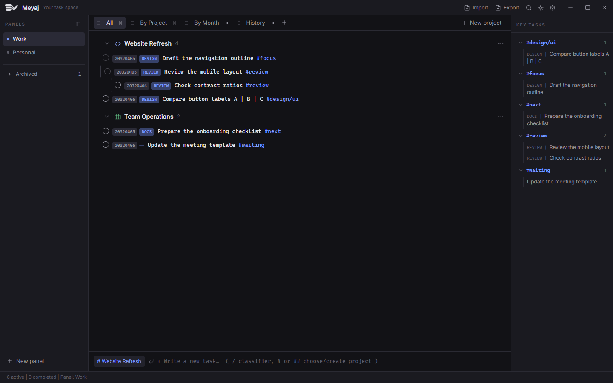

<p align="center">
  
</p>

<h1 align="center">Meyaj</h1>

<p align="center"><strong>A task workspace for work that does not fit into one list.</strong></p>

<p align="center">Local-first · Project-centered · Keyboard-friendly · Markdown-ready</p>

Meyaj is a desktop workspace that keeps **the task, its context, and its next steps together**. Separate areas of work into panels, organize projects inside them, break tasks into actionable children, and use classifiers and hashtags to find connections across your lists.

It is built for the space between a plain Markdown checklist and a heavyweight project management system: structured enough to organize ongoing work, without requiring an account or a hosted service.




## What makes it different?

A task can belong to a **project**, describe a **kind of work**, carry a **cross-project tag**, and contain its own **next steps**—without losing its place.

```text
Panel: Work
├── Project: Website Refresh
│   └── DESIGN | Draft the navigation outline #focus
│       └── REVIEW | Review the mobile layout #review
│           └── Check contrast ratios #review
└── Project: Team Operations
    └── DOCS | Prepare the onboarding checklist #next
```

- **Panels define the workspace.** Keep different areas of work separate; rename them, archive them, and bring them back when needed.
- **Projects keep tasks grounded.** Reorder projects, assign an icon and an accent color, or move a whole project to another panel without rebuilding its task tree.
- **Classifiers describe the work.** Use your own short labels—such as `DESIGN`, `REVIEW`, or `DOCS`—rather than a fixed set of categories.
- **Hashtags connect the work.** The **Key tasks** sidebar groups tagged tasks across projects in the current panel. Tags such as `#focus`, `#waiting`, and `#design/ui` are yours to define; they are not a separate priority system.
- **Children make dependencies visible.** A parent cannot be completed while it has pending children. Completing its last child makes the parent available to complete; it does not close the parent automatically.

## Features

| Area | What you can do |
| --- | --- |
| **Workspace organization** | Create, rename, archive, and permanently delete panels; archived panels live in their own collapsible sidebar section. Deletion requires explicit confirmation and removes the panel's projects, tasks, and history. |
| **Project organization** | Reorder projects, choose from ten project icons, set an accent color, and move projects between active panels. |
| **Task hierarchy** | Create nested subtasks, edit task text, remove indentation, move a task and its descendants to another project, and complete children before their parent. |
| **Views that stay yours** | Switch between All, By Project, By Month, and History. Rename, close, reopen, and reorder the view tabs; their layout is saved locally. |
| **Fast capture** | Open the classifier palette with `/` or `Ctrl/Cmd+P`; type `#` or `##` at the start of the composer to select or create a project. |
| **Visible confirmation** | Newly created tasks scroll into view, receive focus, and get a brief highlight. Reduced-motion preferences are respected. |
| **Search and history** | Search active tasks and completed history with `Ctrl/Cmd+K`; restore completed work when needed. |
| **Markdown portability** | Import standard Markdown checklists or a richer timestamp-and-classifier format; export the current panel to Markdown. |
| **Appearance** | Dark, Light, Dracula, and Nord themes; importable color themes; separate task and interface fonts; font zoom. |
| **Language** | English and Spanish interface options. |
| **Local storage** | SQLite for workspace data, with local interface preferences. No account or hosted backend is required. |

## Try it

Meyaj is in **early development (0.1.0)**. Windows x64 builds are produced as an NSIS installer; source builds remain the development path. Early releases may still change the database or import format, so keep backups before upgrading.

### Install on Windows

Download `Meyaj_0.1.0_x64-setup.exe` from the repository's **Releases** page. The installer is per-user, offers Spanish and English, and does not require administrator access.

The current installer is **not code-signed**, so Windows SmartScreen may show an “Unknown publisher” warning. Verify the SHA-256 checksum published with the release before running it. If you build locally, the installer appears at `src-tauri/target/release/bundle/nsis/`.

The installer and the **About Meyaj** section in Settings include the license, required attribution notice, and third-party notices. No account is needed; data remains on your computer.

### Prerequisites for source builds

- **Node.js 22.18 or later**, with npm.
- A current stable **Rust** toolchain with support for the Rust 2024 edition.
- The [Tauri 2 prerequisites](https://v2.tauri.app/start/prerequisites/) for your operating system.
  - On Windows, install the Microsoft C++ build tools and WebView2 runtime.

Windows development and automated checks have been exercised. Other desktop targets have not been validated yet.

### Run the desktop app

From the repository root:

```sh
npm ci
npm run tauri dev
```

The first launch defaults to Spanish. Open the gear button → **Configuración → Idioma → Inglés** to switch to English. The preference is saved locally.

`npm run dev` starts Vite only. Meyaj depends on Tauri for native window controls, file dialogs, and database commands; a standalone browser is not a supported replacement for the desktop runtime.

### Explore without using your own data

Create a new panel, choose **Import**, and open either bundled example:

| Example | Demonstrates | Imported result |
| --- | --- | --- |
| [`examples/structured-workspace.md`](examples/structured-workspace.md) | Projects, nested tasks, custom classifiers, timestamps, hashtags, subheadings, and completed history. | 6 active tasks in 2 projects, plus 2 history entries. |
| [`examples/markdown-checklist.md`](examples/markdown-checklist.md) | Plain checkboxes, nesting, literal pipes, and checked items—with no classifier or project heading required. | 6 active tasks in `General`, plus 2 history entries. |

Both files contain only synthetic content. The importer tests read these same files, so the examples are executable fixtures rather than documentation-only samples.

## A quick workflow

1. **Choose a panel** for an area of work.
2. **Type `#` or `##`** at the start of the composer to find a project. Matching ignores case and accents. Use the arrow keys and `Enter` or `Tab`, or click a result.
3. **Keep typing to create something new.** If no project has that exact name, choose the explicit **Create project** option. Selecting a suggested project does not create a duplicate.
4. **Choose a classifier with `/`**, or write a task directly. `DESIGN | Review the layout #focus` assigns a classifier and preserves the hashtag in the content.
5. **Add children** from a task's `+` action. Children stay below their parent and inside its project.
6. **Follow the work through different views.** Use project groups for context, the month view for creation dates, and History for completed work.

The `# project` button beside the composer lets you change the destination without losing an existing draft. `Escape` cancels that selection. A hashtag inside task content remains a tag—not a project command.

### Keyboard reference

| Shortcut or action | Result |
| --- | --- |
| `/` in an empty composer | Open the classifier palette. |
| `Ctrl/Cmd+P` | Open the classifier palette. |
| `#` or `##` at the start of the composer | Find or create a project. |
| `↑` / `↓`, then `Enter` or `Tab` | Navigate and accept composer suggestions. `Shift+Tab` keeps its normal focus-navigation behavior. |
| `Ctrl/Cmd+K` | Search tasks and history. |
| Double-click or `F2` on a tab or panel | Rename it; `Enter` confirms and `Escape` cancels. |
| Drag a tab grip | Reorder tabs. For keyboard reordering, focus the grip, press `Space`, use `←` / `→`, and press `Space` again. |
| `Ctrl/Cmd` + `+`, `-`, or `0` | Increase, decrease, or reset the font scale. |
| `Ctrl/Cmd` + mouse wheel | Adjust the font scale. |

## Markdown import and export

The importer uses **syntax**, not a predefined list of project names or classifiers. Your files do not need to match the demonstration topics.

### Standard checklists

```markdown
## Website Refresh

- [ ] Draft the navigation outline #focus
  - [ ] Review the mobile layout
- [x] Approve the initial wireframe ✅ 2032-04-02
```

- Unchecked items become active tasks; checked items become history entries.
- `-`, `*`, and `+` list markers and numbered checklist items are accepted. Checked boxes can use `[x]` or `[X]`.
- Indentation with spaces or tabs creates active task children. A heading starts a new nesting context.
- `##` headings name projects. Items without a project heading go into `General`.
- Plain items do not need a classifier. Missing timestamps use the import time.

### Structured task lines

```markdown
# Active

## 01 - Website Refresh

- [ ] 2032-04-05 09:15 am | **DESIGN** | Draft the navigation outline #focus
  - [ ] 2032-04-05 14:30 | **REVIEW** | Review the mobile layout #review

# History

### Archived Designs

- [x] 2032-04-01 | **DESIGN** | Approve the initial wireframe ✅ 2032-04-02
```

The extended format is `date | classifier | content`. Classifiers are optional, may be bolded, and are registered from the file rather than checked against a hardcoded catalog. Valid date-only, 12-hour, 24-hour, and common ISO/RFC 3339 timestamps are recognized. A valid trailing `✅ YYYY-MM-DD` supplies the completion date.

Optional YAML front matter and fenced code blocks are ignored. `###` and `####` headings supply history labels and reset the nesting context; they do not create extra projects or stored active-task groups. `Active` / `Registro` and `History` / `Historial` section names are understood. Ordinary task text containing pipes is kept intact unless it has a valid structured prefix.

### Scope and limitations

- Import targets the **currently selected panel** and appends tasks and history. Re-importing the same file can create duplicate tasks; use a fresh panel when trying an example.
- Existing project labels are reused within that panel. Project names and classifier names are not tied to any particular domain.
- Completed items are stored as history entries, not as an editable completed subtree.
- Plain text files are accepted only when their contents use the supported Markdown checklist syntax. CSV, JSON task exports, proprietary task-manager exports, and the separate `todo.txt` syntax are not implemented import formats.
- Markdown export is a portable representation of a panel's tasks and history, **not a complete backup** of panels, icons, themes, and application settings. It keeps active-task nesting and calendar dates, but not timestamp precision or the project/subgroup labels attached to history entries.

## Make the workspace feel like yours

Choose a built-in theme in **Settings**, select task and interface fonts, or import a JSON color theme. The menus follow the active theme rather than relying on operating-system dropdown styling. Font choices use fonts installed on your computer, with system fallbacks; Meyaj does not bundle or download the listed fonts.

[`public/meyaj-theme-example.json`](public/meyaj-theme-example.json) is a complete importable example. A minimal theme looks like this:

```json
{
  "name": "My workspace",
  "colors": {
    "bg": "#121216",
    "text": "#e4e4ea",
    "accent": "#7b9bff"
  }
}
```

Supported tokens: `bg`, `bgElevated`, `bgHover`, `bgActive`, `border`, `borderStrong`, `text`, `textDim`, `textFaint`, `accent`, `accentDim`, `danger`, `success`, and `selection`.

Colors may use supported hex, `rgb`/`rgba`, or `hsl`/`hsla` values. Missing tokens fall back to the dark base. Invalid themes are rejected without replacing the current theme; external CSS, `url()`, and `var()` are not loaded. One imported theme is kept at a time, and switching to a built-in theme does not delete it.

## Data and privacy

Workspace data lives in `meyaj.db` inside Tauri's per-application data directory. Appearance, language, tab layout, and other interface preferences are stored locally in the webview.

- No account or application-hosted cloud sync is required.
- Tasks are not automatically published to this repository.
- The database is not encrypted by the application. Treat it and any exported Markdown as potentially sensitive.
- Close the app before copying the database for a backup. A database-only backup does not include webview preferences.
- Private imports belong outside the repository, or in an ignored `private/` or `local-data/` directory. Database files and environment secrets are also covered by the repository's ignore rules. Ignore rules do not untrack files that were already committed.

Automatic cloud synchronization, multi-user collaboration, recurring tasks, reminders, and due-date scheduling are not implemented features. The month view groups tasks by **creation date**, not by due date.

## Development

| Command, from the repository root | Purpose |
| --- | --- |
| `npm run tauri dev` | Run the desktop app with the frontend development server. |
| `npm run build` | Type-check and build the frontend. |
| `npm test` | Run the Node-based frontend utility and store tests. |
| `cargo test --locked --manifest-path src-tauri/Cargo.toml` | Run Rust and in-memory SQLite tests, including the public import examples. |
| `npm run licenses:third-party` | Regenerate `THIRD_PARTY_NOTICES.txt` from installed locked dependencies. |
| `npm run release:windows` | Regenerate notices and build the unsigned Windows x64 NSIS installer. |
| `npm run tauri -- build` | Build native application bundles for the current platform. |

Release preparation and GitHub publication steps are documented in [`RELEASING.md`](RELEASING.md). macOS requires its own build host; a DMG cannot be produced reliably from Windows.

An optional private-file compatibility test is ignored by default. Set `MEYAJ_IMPORT_SMOKE_FILE` to a local Markdown file outside the source tree, then run `cargo test --locked --manifest-path src-tauri/Cargo.toml smoke_import_local_markdown -- --ignored --nocapture`. It imports into an in-memory database and reports counts, not task contents.

### Repository layout

```text
meyaj_task_workspace/
├── README.md                  This guide
├── LICENSE                    PolyForm Noncommercial 1.0.0
├── NOTICE                     Required attribution notice
├── THIRD_PARTY_NOTICES.txt    Licenses and credits for dependencies
├── RELEASING.md               Build and GitHub release checklist
├── assets/                    Public documentation images
├── examples/                  Synthetic, tested import files
├── public/                    Logo, favicon, and example color theme
├── scripts/                   Reproducible third-party notice generator
├── src/                       React UI, Zustand store, and TypeScript utilities
├── src-tauri/                 Rust commands, SQLite schema, importer, and native icons
├── tests/                     Frontend utility and store tests
└── third-party/licenses/      Supplemental upstream license texts
```

**Stack:** Tauri 2, React 19, TypeScript, Zustand, SQLite/SQLx, dnd-kit, Tailwind CSS, and Lucide. The interface and database run locally; no separate application server is needed.

### Contributing

Bug reports are most useful with an expected result, reproduction steps, operating system, and a small **synthetic** example. For importer changes, add an anonymized fixture and a regression test. Never attach a personal task database or private work list without reviewing and sanitizing it first.

Before proposing a change, run the frontend tests, frontend build, and Rust tests listed above. Keep changes focused and document any change to the Markdown format or database behavior.

## License and attribution

Meyaj's original code and original project artwork are available under the **[PolyForm Noncommercial License 1.0.0](LICENSE)**. This permits noncommercial use—including the personal, educational, public-research, charitable, and government uses defined by the license—but **does not permit commercial use**. A separate license from the copyright holder is required for commercial purposes.

When you distribute copies or works based on Meyaj, you must include the license terms and the required notice. The attribution requirements are collected in [`NOTICE`](NOTICE):

> Required Notice: Copyright (c) 2026 Jorge A. Tzec-Interián.
> Required Notice: Meyaj Task Workspace was created by Jorge A. Tzec-Interián.

Preserve those lines and the `NOTICE` file, and do not remove attribution from the interface or distributed builds. PolyForm Noncommercial is a source-available license, not an OSI-approved open-source license.

Third-party dependencies keep their own licenses. Their notices are reproduced in [`THIRD_PARTY_NOTICES.txt`](THIRD_PARTY_NOTICES.txt); the Meyaj license does not replace or relicense them. The license does not claim ownership of your tasks, database, imports, or exports.

The copyright holder and creator credited in this repository is **Jorge A. Tzec-Interián**.
